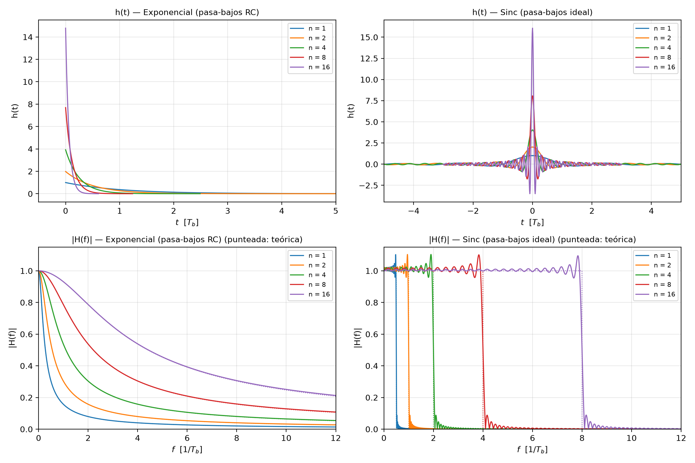
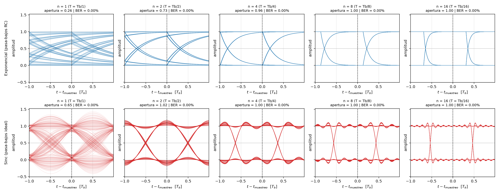
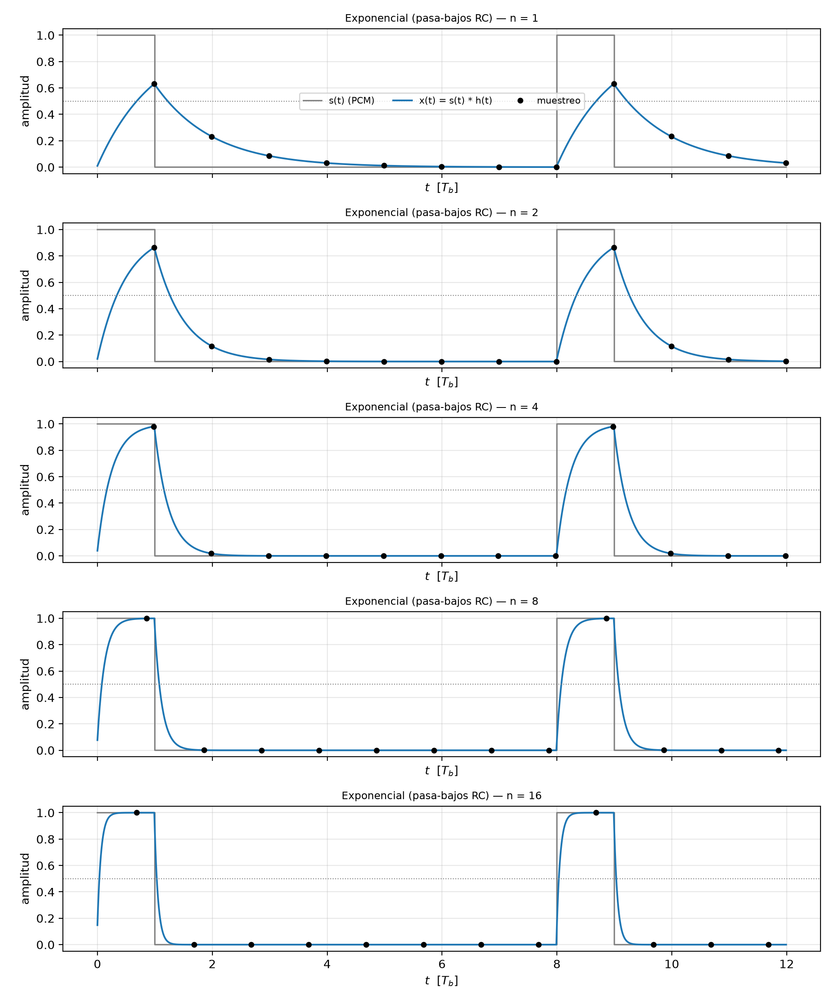
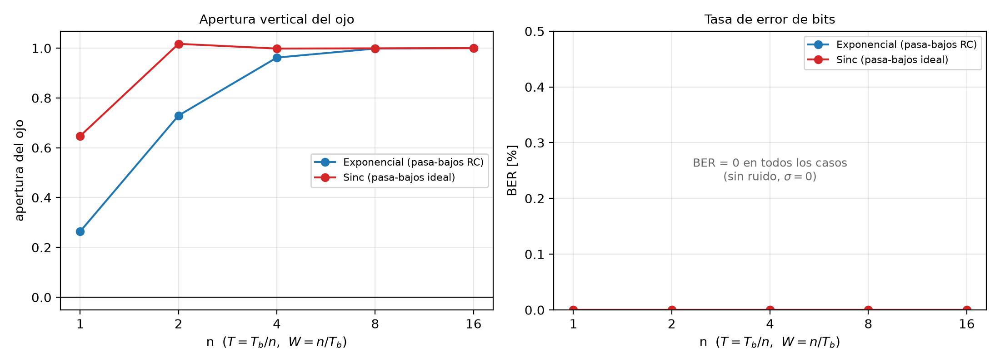

# Trabajo 1 — Procesamiento de señales utilizando la convolución

**Tema elegido:** canal de comunicaciones — transmisión PCM por un canal LTI de
ancho de banda limitado.

**Asignatura:** Sistemas Lineales y Señales · Universidad de Cuenca.

El trabajo implementa en Python la cadena `s(t) → h(t) → x(t)` del enunciado:
los bits de un archivo de audio sin comprimir (`.wav`) se transmiten con
modulación PCM, atraviesan un canal modelado por su respuesta al impulso `h(t)`
y se reciben con un detector por umbral. El efecto del ancho de banda del canal
se analiza con el **diagrama de ojo**, la apertura vertical y la tasa de error
de bits (BER).

---

## 1. Modelo

### 1.1 Señal PCM transmitida

Cada muestra del audio se cuantiza a 8 o 16 bits (binario natural, MSB primero)
y el flujo de bits `b_k` se transmite con pulsos rectangulares:

```
s(t) = Σ b_k · g(t − k·Tb),      g(t) = u(t) − u(t − Tb)
```

con `Tb = 1 s` (tiempo de bit normalizado) y `b_k ∈ {0, 1}`.

### 1.2 Canal LTI de ancho de banda limitado

Se estudian los dos modelos propuestos en el enunciado:

| Canal | Respuesta al impulso | Ancho de banda |
|---|---|---|
| Exponencial (pasa-bajos RC) | `h(t) = (1/T)·e^(−t/T)·u(t)` | `W = 1/T` |
| Sinc (pasa-bajos ideal) | `h(t) = (1/T)·sinc(t/T)` | `W = 1/T` |

donde `sinc(x) = sin(πx)/(πx)`. La señal recibida es la convolución

```
x(t) = s(t) ∗ h(t)
```

Para barrer el ancho de banda se usa `T = Tb/n` con `n = 1, 2, 4, 8, 16`, de
modo que `W = n/Tb`. Un `n` pequeño corresponde a un canal estrecho (más
distorsión); un `n` grande, a un canal ancho (la señal pasa casi sin cambios).

### 1.3 Discretización y simulación

El tiempo se discretiza con `sps = 100` muestras por bit (`dt = Tb/sps`) y la
convolución continua se aproxima por la suma de Riemann

```
x[i] = dt · Σ_j s[j] · h[i−j]
```

calculada con FFT (`scipy.signal.fftconvolve`). La respuesta exponencial es
causal; la sinc es simétrica y se trunca a `|t| ≤ max(20·T, 3·Tb)`,
compensando su retardo para alinear `x(t)` con `s(t)`. Ambas `h(t)` se
normalizan para tener ganancia DC unitaria (`∫h(t)dt = 1`).

### 1.4 Recepción y diagrama de ojo

- **Instante de muestreo:** se elige, sobre la señal sin ruido, el instante
  dentro del bit que maximiza la apertura vertical del ojo.
- **Decisión:** umbral fijo en `0.5`.
- **Apertura del ojo:** `min(x | b_k = 1) − max(x | b_k = 0)` en el instante de
  muestreo. Si es positiva el ojo está abierto; si es negativa (o nula), el
  ruido o la interferencia entre símbolos (ISI) provocan errores.
- **BER:** proporción de bits recibidos distintos de los transmitidos.

El diagrama de ojo se construye superponiendo trazas de `2·Tb` centradas en el
instante de muestreo.

---

## 2. Archivos del repositorio

| Archivo | Descripción |
|---|---|
| `canal_pcm.py` | Núcleo: lectura/escritura de `.wav`, cuantización, señal PCM, respuestas al impulso, convolución, ojo, detección y BER. |
| `graficas.py` | Funciones de dibujo compartidas (señales, `h(t)`, `|H(f)|`, ojo y resumen). |
| `generar_figuras.py` | Genera todas las figuras, la tabla CSV y los audios reconstruidos del informe. |
| `app.py` | Interfaz interactiva en Streamlit para explorar los 10 casos y escuchar el resultado. |
| `salida/` | Resultados generados: figuras, `tabla_resultados.csv` y audios `.wav`. |
| `docs/enunciado_T1.pdf` | Enunciado del trabajo. |
| `requirements.txt` | Dependencias (`numpy`, `scipy`, `matplotlib`, `streamlit`). |

---

## 3. Ejecución

```bash
pip install -r requirements.txt

# Figuras y tabla con el audio sintético de prueba
python generar_figuras.py

# Con un audio propio sin comprimir
python generar_figuras.py --wav mi_audio.wav --max-muestras 500

# Interfaz interactiva
streamlit run app.py
```

Parámetros principales de `generar_figuras.py`:

| Opción | Valor por defecto | Descripción |
|---|---|---|
| `--wav` | audio sintético | Archivo `.wav` de entrada. |
| `--max-muestras` | `500` | Muestras de audio a transmitir (cada una aporta 8 o 16 bits). |
| `--inicio` | `0` | Muestra inicial del audio. |
| `--bits-por-muestra` | `8` | `8` o `16` bits por muestra. |
| `--sps` | `100` | Muestras de simulación por bit. |
| `--sigma` | `0.0` | Desviación estándar del ruido gaussiano a la salida del canal. |
| `--salida` | `salida` | Carpeta de resultados. |

> La simulación usa 500 muestras (4000 bits) del audio de prueba para que los
> 10 casos se calculen en pocos segundos. Con audios completos el número de
> bits crece varios órdenes de magnitud.

---

## 4. Resultados

Parámetros: audio sintético de 500 muestras a 8 kHz, 8 bits/muestra
(**4000 bits**), `sps = 100`, sin ruido (`σ = 0`).

| Canal | n | T [Tb] | W [1/Tb] | t_muestreo [Tb] | Apertura | Errores | BER |
|---|---:|---:|---:|---:|---:|---:|---:|
| Exponencial | 1 | 1.0000 | 1 | 0.99 | 0.2643 | 0 | 0.00 % |
| Exponencial | 2 | 0.5000 | 2 | 0.99 | 0.7294 | 0 | 0.00 % |
| Exponencial | 4 | 0.2500 | 4 | 0.98 | 0.9620 | 0 | 0.00 % |
| Exponencial | 8 | 0.1250 | 8 | 0.86 | 0.9982 | 0 | 0.00 % |
| Exponencial | 16 | 0.0625 | 16 | 0.68 | 1.0000 | 0 | 0.00 % |
| Sinc | 1 | 1.0000 | 1 | 0.49 | 0.6475 | 0 | 0.00 % |
| Sinc | 2 | 0.5000 | 2 | 0.50 | 1.0172 | 0 | 0.00 % |
| Sinc | 4 | 0.2500 | 4 | 0.63 | 0.9982 | 0 | 0.00 % |
| Sinc | 8 | 0.1250 | 8 | 0.56 | 0.9991 | 0 | 0.00 % |
| Sinc | 16 | 0.0625 | 16 | 0.53 | 1.0000 | 0 | 0.00 % |









Los audios recibidos (`salida/audio/rx_<canal>_n<n>.wav`) permiten escuchar el
efecto. Sin ruido no hay errores de bit, por lo que la reconstrucción es
idéntica al audio cuantizado; el efecto del canal se hace audible al añadir
ruido (`--sigma` o el control de la app), donde los casos de menor apertura
producen clics. La diferencia entre `n = 1` y `n = 16` se aprecia sobre todo en
el margen del ojo y en la forma de los pulsos recibidos.

---

## 5. Discusión y conclusiones

1. **El ancho de banda del canal controla la ISI.** Para `n = 1` (`W = 1/Tb`)
   el pulso rectangular, que tiene lóbulos laterales infinitos, se dispersa y
   el ojo se cierra parcialmente (apertura `0.26` en el canal exponencial). Al
   aumentar `n`, el canal deja pasar más armónicos, los flancos se hacen más
   abruptos y la apertura tiende a `1`.
2. **El canal exponencial es más selectivo en frecuencia** que el sinc para el
   mismo `W` nominal: su `|H(f)|` decae suavemente desde la continua, mientras
   que el sinc es plano hasta `W` y corta bruscamente. Por eso, con `n = 1`, el
   ojo del sinc (apertura `0.65`) está más abierto que el del exponencial
   (`0.26`).
3. **Sin ruido no hay errores de bit** en ninguno de los 10 casos: mientras la
   apertura sea positiva, el detector por umbral `0.5` recupera todos los bits
   (`BER = 0`). El efecto del canal se manifiesta como **margen** reducido
   frente al ruido; al aumentar `σ` en `app.py`, los casos con menor apertura
   son los primeros en presentar errores.
4. **El truncamiento de la sinc** introduce rizado de Gibbs en `|H(f)|`
   (visible en la figura): es el precio de aproximar un filtro ideal de
   duración infinita con una respuesta de duración finita.
5. La convolución discreta con `sps = 100` y la normalización de `h(t)` a
   ganancia DC unitaria reproducen con buena fidelidad el modelo continuo; la
   comparación entre `|H(f)|` numérica y teórica valida la implementación.

---

## 6. Referencias

- A. V. Oppenheim, A. S. Willsky y S. H. Nawab, *Signals and Systems*,
  2.ª ed., Prentice Hall, 1997.
- J. G. Proakis y M. Salehi, *Communication Systems Engineering*, 2.ª ed.,
  Prentice Hall, 2002.
- Universidad de Cuenca, *Trabajo 1: Procesamiento de señales utilizando la
  convolución* (enunciado), 2026.
